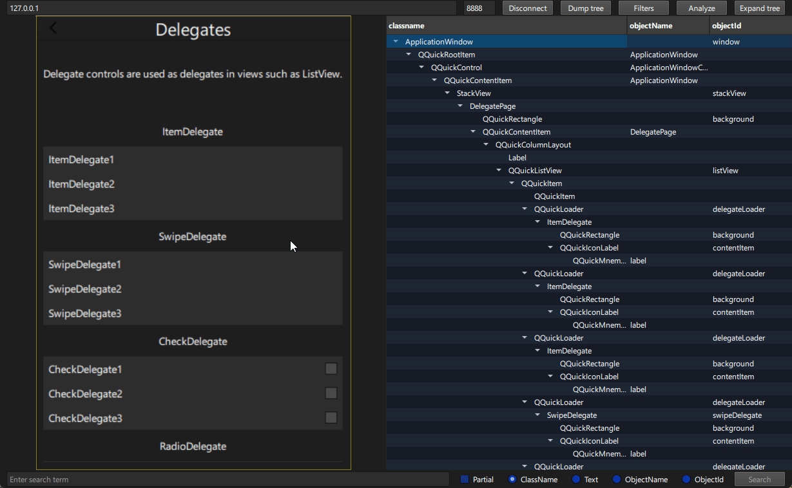

# qt-qaengine-inspector

Desktop inspector for an application that has [qt-qaengine](https://github.com/CODeRUS/qt-qaengine) loaded. It connects to that process over TCP, reads the live object tree, and can search, filter, and dump it. It does not link the automation library. The application under test must already be listening.

This is not an official Qt tool.

## Showcase

Dump tree loads the object tree and a picture of the window. Click a control on the picture to select its row. The frame on the picture is that object's rectangle.



## Projects

| Project | Role |
| --- | --- |
| [qt-qaengine](https://github.com/CODeRUS/qt-qaengine) | In-process library. Listens on the socket. |
| [qt-qaengine-inspector](https://github.com/CODeRUS/qt-qaengine-inspector) | This application. |
| [qt-qaengine-driver](https://github.com/CODeRUS/qt-qaengine-driver) | Appium 2 driver and MCP server for the same socket. |

The inspector speaks only protocol version 1 of qt-qaengine. The wire format is documented in that repository: [protocol](https://github.com/CODeRUS/qt-qaengine/blob/master/docs/protocol.md). On connect it sends `hello`, checks that the peer is `qt-qaengine` at protocol 1, then sends `initialize`.

## What you can do

- Connect to a host and port. The fields default to `127.0.0.1` and `8900`.
- Dump the object tree and expand it.
- Search by class name, text, object name, or object id.
- Filter the tree and run the analyze view.
- Select an object in the running application.

The window title is **Qt QA Engine Inspector**. Connection, column layout, and filters are stored in `qt-qaengine-inspector.ini` under the application config directory (`organizationName` `qt-qaengine`).

## Requirements

- CMake 3.16 or newer
- Qt 6.5 or newer: Quick and Core
- A C++ compiler for that Qt build

The inspector is a Qt 6 application. The application under test may be the Qt 5 or Qt 6 build that [qt-qaengine](https://github.com/CODeRUS/qt-qaengine) was built for. Only the socket has to match.

## Build

Single-config generators:

```bash
cmake -S . -B build -DCMAKE_BUILD_TYPE=Release
cmake --build build
```

Visual Studio and other multi-config generators:

```bash
cmake -S . -B build
cmake --build build --config Release
```

The executable is `qt-qaengine-inspector`. On macOS it is a bundle with identifier `dev.qtqaengine.inspector`.

Windows, same Visual Studio generator as the library. The inspector's Qt does not have to be the Qt of the application under test. Only the socket protocol has to match.

```powershell
cmake -S . -B build -G "Visual Studio 17 2022" -A x64 -T v143 -DCMAKE_PREFIX_PATH="C:/Qt/6.11.1/msvc2022_64"
cmake --build build --config Release
```

Installing the Appium driver and the MCP server is documented in the [qt-qaengine-driver](https://github.com/CODeRUS/qt-qaengine-driver) README (`npm run build`, `npx appium driver install --source=local .`, and the Cursor `mcp.json` entry for `build/mcp.js`).

## Connect

1. Start the application under test with [qt-qaengine](https://github.com/CODeRUS/qt-qaengine) loaded. Set `QTQAENGINE_PORT` if you are not using 8900.
2. Start `qt-qaengine-inspector`.
3. Enter the host and port and press **Connect**.
4. Press **Dump tree** after the connection is up.

If the peer does not answer the hello frame with protocol 1 and product `qt-qaengine`, the inspector closes the socket.

## License

Noncommercial use is under [PolyForm Noncommercial 1.0.0](LICENSE).

[OPEN_SOURCE_GRANT](OPEN_SOURCE_GRANT) is a separate permission. It lets you install, copy, and run this software to develop and test a program that is publicly available under an OSI-approved license or an FSF free-software license. A company may use that permission. It does not cover a proprietary program, including a proprietary program in the same repository or the same CI job. It does not allow shipping this software inside a product, and it does not allow relicensing it under the other program's license.

Copyright (c) 2026 Andrei Kozhevnikov. The required notice is in [NOTICE](NOTICE).

## Commercial Licensing

Using this application in commercial products requires a separate license. Contact me at [coderus@duck.com](mailto:coderus@duck.com) and on Telegram at [https://t.me/icoderus](https://t.me/icoderus) to discuss pricing and terms. I also provide paid services for integrating automated tests into your infrastructure.
